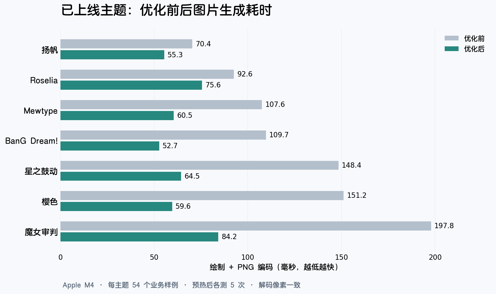

# 已上线主题渲染优化：2026-10-27

按当前仓库的默认主题与可装备主题目录，覆盖 BanG Dream!、扬帆、星之鼓动、Mewtype、Roselia、魔女审判、樱色 7 个主题。保持 2× 采样，解码后的像素与原代码一致。

## 结果

本机 Apple M4、Python 3.12.11、Pillow 11.3.0。每主题 54 类业务样例，另测 17 类公共组件的 1×/2× 和各主题专有组件组合，共 626 个组合，零渲染错误。每个组合先执行一次，再预热一次，然后测 5 次。下表是各业务场景总耗时中位数的中位数，包含页面构建、绘制、缩图与 PNG 编码。

| 主题 | 优化前 ms | 优化后 ms | 耗时降低 |
| --- | ---: | ---: | ---: |
| BanG Dream! | 109.7 | 52.7 | 52.0% |
| 扬帆 | 70.4 | 55.3 | 21.4% |
| 星之鼓动 | 148.4 | 64.5 | 56.6% |
| Mewtype | 107.6 | 60.5 | 43.7% |
| Roselia | 92.6 | 75.6 | 18.4% |
| 魔女审判 | 197.8 | 84.2 | 57.4% |
| 樱色 | 151.2 | 59.6 | 60.6% |



所有场景等权，不能直接视为生产流量的平均响应时间。不包含数据库读取、头像下载、线程池排队与消息传输；缓存命中率和并发负载会影响实际收益。

## 改动

1. `plugins/render/raster_cache.py`：为静态栅格图层提供共享 LRU，按保留的像素内存限制为 64 MiB，同时最多 128 项。超限的大图直接绘制；构建在锁外执行，命中后返回独立副本，避免不同渲染请求互相改动画布。
2. `plugins/render/kits/atoms.py`：阴影/发光层按尺寸、颜色、圆角和模糊参数复用；带字间距的文字按字体对象和字符复用精确字形边界，最多 8192 项。排版、字距和抗锯齿算法保持相同。
3. 各已上线主题背景按主题参数、随机种子、倍率和尺寸复用；未固定种子的效果、可变参数和内存图片绕过背景缓存。BanG Dream! 的固定素材图片背景也覆盖扫雷、一笔画。
4. 魔女审判的书纸按尺寸和书脊位置复用，省去相同版式的重复切分及缩放。
5. `utils/images.py`：统一字节编码与消息编码，使用无损 PNG 三级压缩；完全不透明的 RGBA 图片编码为 RGB，存在透明度时保留 RGBA。调用方的原图片保持不变。

## 字间距文字的首次换行

对 Mewtype 巡演帮助页做控制变量实验：只切换旧/新 `_TrackedFont.getbbox`，每次清空换行、字形度量和静态图层缓存；字体可保持加载状态。各测 3 次，6 张输出的像素哈希一致。
旧实现中位数 **1991.6 ms**，新实现 **188.5 ms**，降低 **90.5%**。这反映换行缓存未命中的改进，不是完整进程冷启动指标。

回归测试中的中英文混排短段落，旧实现反复读取了 16,361 次字形边界；测试将此类重复读取限制在 500 次以内，当前实现通过。

## PNG 速度与体积

| 主题 | 编码前 ms | 编码后 ms | 文件体积中位数变化 |
| --- | ---: | ---: | ---: |
| BanG Dream! | 12.5 | 8.8 | +3.1% |
| 扬帆 | 11.2 | 8.4 | -5.0% |
| 星之鼓动 | 15.4 | 10.0 | -3.8% |
| Mewtype | 13.9 | 10.3 | -4.2% |
| Roselia | 12.8 | 9.7 | -3.9% |
| 魔女审判 | 101.0 | 30.4 | -4.6% |
| 樱色 | 14.2 | 9.6 | -3.4% |

像素保持无损；体积变化是压缩等级和省略不透明 Alpha 通道共同作用的结果。BanG Dream! 的图片体积中位数增加约 3.1%，个别场景最多增加约 18.3%；其余主题的体积中位数下降约 3–5%。

## 画面与回归验证

- 626 个页面/组件组合与修改前逐像素比较通过，覆盖 1× 和 2×。
- 一笔画的实时奖励和背景选择依赖经过时间及游戏创建时间；预览样例已固定这两个值。涉及该样例的 7 个主题及 BanG Dream! 扫雷，共 8 个场景用 Git HEAD 的原渲染/编码代码与最终代码重新测量、比较像素。
- 原始基准数据保持原样；比较这些动态游戏样例时使用上述补测的旧代码数据。其余场景沿用上一轮基准。
- 新增回归覆盖：冷换行的字形读取次数、缓存内存淘汰、副本隔离、4 个 worker 并发、背景种子/倍率与可变源图绕过缓存、PNG 的透明/不透明像素一致性。

最终全量回归通过：**1136 个测试、493 个子测试**（73.12 秒）。修改文件的 Ruff 检查、`git diff --check` 均通过。布局审计覆盖 54 个共享预览样例及 1 个部分填充的排行榜样例，共 55 页，无文字重叠或越界。

## 复现

```bash
.venv/bin/python scripts/benchmark_render.py \
  --kits bangdream sailing kasumi mewtype roselia manosaba sakura \
  --repeats 5 --output-dir .cache/render-benchmark-optimized-2026-10-27

.venv/bin/python -m pytest -q
```

原始数据与完整矩阵：

- `.cache/render-benchmark-2026-10-27/results.json`：上一轮基准。
- `.cache/render-benchmark-optimized-2026-10-27/results.json` / `results.csv` / `report.md`：最终 626 个组合。
- `.cache/render-optimize/comparison.json`：7 个主题的汇总对比。
- `.cache/render-optimize/fixed-games-legacy.json` / `fixed-games-optimized.json`：固定游戏样例的原代码与优化代码数据。
- `.cache/render-optimize/pixel-comparison.json`：像素核验记录。
- `.cache/render-optimize/cold-wrap-comparison.json`：换行缓存未命中的控制变量实验。
